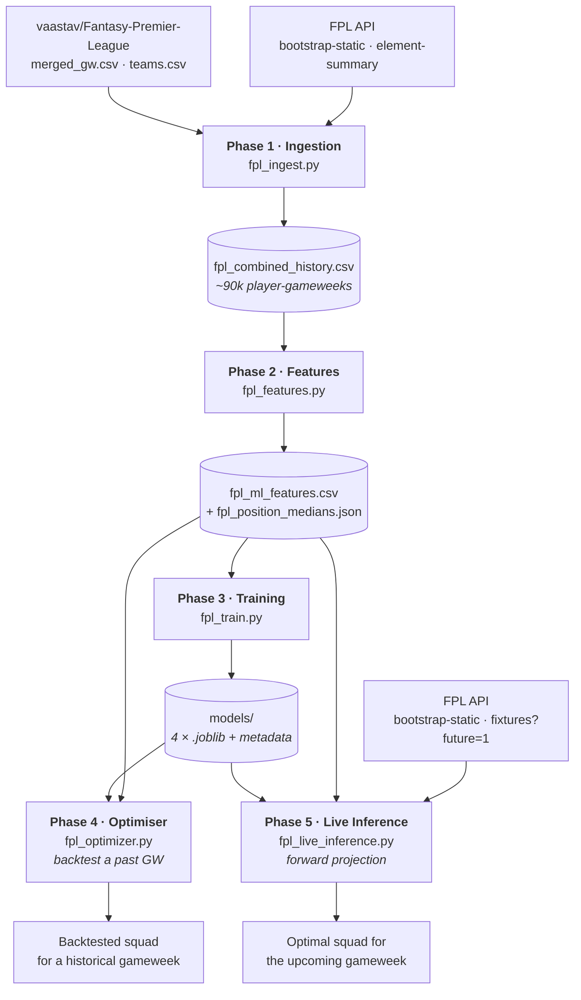

# FPL Machine Learning Pipeline

[](https://www.python.org/)
[](https://xgboost.readthedocs.io/)
[](https://coin-or.github.io/pulp/)
[](https://pandas.pydata.org/)
[](https://scikit-learn.org/)
[](LICENSE)
[](https://peps.python.org/pep-0008/)

An end-to-end machine learning and mathematical optimisation pipeline for
**Fantasy Premier League**. It ingests three seasons of gameweek-level data,
engineers strictly causal time-series features, trains position-specific
gradient-boosted regressors, and solves for the mathematically optimal 15-man
squad under the full set of FPL rules using mixed-integer linear programming.

---

## Overview

FPL is two problems wearing a trench coat:

1. **A forecasting problem.** How many points will each of ~700 players score in
   the upcoming gameweek?
2. **A constrained combinatorial problem.** Given those forecasts, which 15
   players maximise expected return subject to a £100.0m budget, positional
   quotas, a three-per-club limit, and a legal starting formation?

This repository solves both. Point forecasts come from four XGBoost regressors,
one per position, trained on a strictly temporal split with a hard guarantee that
no post-match information reaches the feature matrix. Squad selection is a
multi-dimensional knapsack solved exactly — not greedily — by CBC via PuLP.

**What makes this different from a notebook:** every stage that *could* leak
future information is guarded by an assertion that fails the run rather than
silently producing an optimistic backtest. Those guards are documented in
[Leakage Guarantees](#leakage-guarantees) and they have caught real bugs during
development.

---

## Architecture



### Phase 1 — Data Ingestion (`fpl_ingest.py`)

Two sources, one harmonised schema.

| Source | Endpoint / path | Covers |
| --- | --- | --- |
| Official FPL API | `bootstrap-static/`, `element-summary/{id}/` | Current season, refreshed each gameweek |
| vaastav archive | `data/{season}/gws/merged_gw.csv`, `teams.csv` | Completed seasons |

The archive's schema drifts between seasons — `mng_*` columns appeared in
2024/25, `defensive_contribution` in 2025/26 — so each season is normalised
independently, unknown columns are dropped with a log line, and absent ones are
NaN-filled with an explicit report. Requests carry a real `User-Agent`, retry with
exponential backoff on 429/5xx, sleep 0.5 s between player calls, and cache raw
JSON to disk so a re-run after a failure costs seconds rather than ten minutes.

> [!IMPORTANT]
> **`player_id`, `opponent_team_id` and `fixture` are season-scoped.** The FPL
> `element` id is re-issued every year — id 328 is one player in 2023-24 and
> someone else in 2025-26. Always join on `(season, player_id)`. `player_name` is
> the cross-season key.

### Phase 2 — Feature Engineering (`fpl_features.py`)

1. **Drops `xp`** — the archive scrapes FPL's expected-points figure *after* the
   fixture resolves. Any model that sees it is reading the answer sheet.
2. **Applies two community adjustments** to raw rows before any windowing:
   `expected_assists × 1.4` (fantasy assists are awarded more loosely than the
   xA definition), and `clean_sheet_probability = exp(-xGC)` (goals conceded are
   near-Poisson, so this is a calibrated P(0 conceded)).
3. **Builds rolling means over 3 / 5 / 10 gameweeks** for `minutes`,
   `total_points`, `expected_goals`, `expected_assists`,
   `defensive_contribution` and `clean_sheet_probability`. The `.shift(1)`
   happens **before** `.rolling(...)`, so the window for gameweek *N* covers
   *N-1* and older and never *N* itself.
4. **Imputes cold starts** with position medians and keeps every row. The
   imputer is a `fit`/`transform` class persisted to JSON, so the same medians
   apply at train and serve time.

Rows are sorted by `(player, season, gameweek, kickoff_time)`. That last key
matters: in a double gameweek two rows share a `gameweek`, and without a stable
tiebreak `.shift(1)` can hand the later fixture's result to the earlier one.

### Phase 3 — Model Training (`fpl_train.py`)

| | |
| --- | --- |
| **Split** | Train `2023-24` + `2024-25`, test `2025-26`. Strictly temporal. |
| **Validation** | Tail 10 gameweeks of the last training season, for early stopping. Never random. |
| **Models** | Four independent regressors — GKP / DEF / MID / FWD. |
| **Backends** | XGBoost (default), LightGBM, or scikit-learn `HistGradientBoosting`. |
| **Features** | Allowlist: `*_roll_<n>`, `gw_cost`, `was_home`, `games_prior`, `is_cold_start`, position indicators. |
| **Metrics** | MAE and RMSE, reported per position against three naive baselines. |
| **Importance** | Gain plus permutation importance on the test season, as CSV and PNG. |

Feature selection is an allowlist with `assert_no_post_match_features()` behind
it: `minutes`, `bps`, `bonus`, raw `expected_goals` and friends are only knowable
after the whistle, and the run aborts if any reaches the matrix.

There is deliberately **no `.shift(-1)` on the target**. Phase 2 already built
row *N*'s features from *N-1* and older, so `(features_N, total_points_N)` is
already a next-gameweek example.

### Phase 4 — Squad Optimisation (`fpl_optimizer.py`)

A mixed-integer linear program over three families of binary decision variable:

| Variable | Meaning |
| --- | --- |
| $x_i \in \{0,1\}$ | player *i* is in the 15-man squad |
| $s_i \in \{0,1\}$ | player *i* starts |
| $c_i \in \{0,1\}$ | player *i* is captain |

$$\max \sum_i \big(s_i + c_i\big)\, \hat{p}_i \;+\; w_b \sum_i \big(x_i - s_i\big)\, \hat{p}_i$$

The `+ c_i` term is what doubles the captain: he scores once as a starter and
again as captain. $w_b$ is a configurable bench weight, `0` by default.

| Constraint | Formulation |
| --- | --- |
| Squad size | $\sum_i x_i = 15$ |
| Positional quota | $\sum_{i \in \text{pos}} x_i = 2/5/5/3$ |
| Budget | $\sum_i \text{cost}_i\, x_i \le 100.0$ |
| Club quota | $\sum_{i \in \text{club}} x_i \le 3$ |
| Starting XI | $\sum_i s_i = 11$ |
| Hierarchy | $s_i \le x_i$, $c_i \le s_i$ |
| Formation | GKP 1, DEF 3–5, MID 2–5, FWD 1–3 |
| Captaincy | $\sum_i c_i = 1$ |

A pre-solve feasibility check turns `Infeasible` into a usable diagnostic
("cheapest legal squad costs 75.5, budget is 70.0"), and `validate_squad()`
re-checks the returned solution against all seven rules independently of the
solver.

### Phase 5 — Live Inference & Forward Projection (`fpl_live_inference.py`)

Bridges the gap between backtesting and acting:

1. Pulls live `bootstrap-static` for current `now_cost` and `status`; keeps only
   `status == 'a'`.
2. Pulls `/fixtures/?future=1`, resolves the next gameweek from the `is_next`
   event flag, and reads each player's real `was_home` and `opponent_team`.
3. **Recomputes** rolling form over the player's last *k* gameweeks
   *inclusive* of the most recent one — see the note below.
4. Scores with the Phase 3 models and hands the frame to `SquadOptimizer`.

> [!NOTE]
> **Forward features are recomputed, not copied.** Reusing the rolling values on
> a player's latest Phase 2 row looks equivalent but is not: those windows are
> shifted, so they summarise *N-1* and older and exclude gameweek *N* entirely.
> Carrying them forward to predict *N+1* throws away the most recent — and most
> informative — gameweek. `--reuse-last-row` restores the naive behaviour if you
> want to measure the difference.

Blank gameweeks produce no rows (correctly excluding the player); double
gameweeks produce two rows, scored separately and summed, labelled
`ARS (H) + CHE (A)` in the report.

---

## Setup

```bash
git clone https://github.com/<your-username>/fpl-ml-pipeline.git
cd fpl-ml-pipeline

python -m venv .venv
source .venv/bin/activate          # Windows: .venv\Scripts\activate

pip install -r requirements.txt
```

**Requirements:** Python 3.10+. PuLP bundles the CBC solver, so no separate
solver install is needed. LightGBM is optional (`--model lightgbm`).

---

## Usage

### End-to-end

```bash
# Phase 1 — ingest three archive seasons + the live season  (~10 min, rate-limited)
python fpl_ingest.py --seasons 2023-24 2024-25 2025-26

# Phase 2 — engineer causal features  (leakage assertion runs by default)
python fpl_features.py

# Phase 3 — train four position models and write models/
python fpl_train.py

# Phase 4 — backtest: optimal squad for a historical gameweek
python fpl_optimizer.py --gameweek 38

# Phase 5 — live: optimal squad for the UPCOMING gameweek
python fpl_live_inference.py
```

### Common variations

```bash
# Fast smoke test of the ingestion path (25 players, verbose)
python fpl_ingest.py --limit 25 --log-level DEBUG

# Archive only — skips the slow per-player API loop entirely
python fpl_ingest.py --skip-live

# Scope imputation medians per season, so 2023-24 rows are not filled
# from 2025-26 data (see Known Limitations)
python fpl_features.py --median-groups position season

# Swap the model backend, or shrink the search
python fpl_train.py --model lightgbm --n-estimators 500

# Buy a bench that survives rotation instead of four £4.0m bodies
python fpl_live_inference.py --bench-weight 0.15

# Include 75%-doubtful players — often the best value picks of the week
python fpl_live_inference.py --allow-status a d --min-chance 75
```

Every script exposes `--help`, `--log-level`, and sensible defaults.

### Sample output

```
==================================================================================
                       OPTIMAL SQUAD — UPCOMING GAMEWEEK 12
                          deadline 2026-11-12T11:00:00Z
==================================================================================

STARTING XI  (5-2-3)
  POS  PLAYER                   TEAM          FIXTURE             COST    xPTS
  ------------------------------------------------------------------------------
  GKP  Raya                     Arsenal       BUR (H)              5.6    4.31
  DEF  Gabriel                  Arsenal       BUR (H)              6.3    5.02
  ...
  FWD  Haaland (C)              Man City      EVE (H) + LEE (A)   15.1   12.84
  ------------------------------------------------------------------------------
       XI subtotal                                                83.5   66.71

----------------------------------------------------------------------------------
  Captain            Haaland (+12.84 doubled)
  Squad cost         99.9 / 100.0   (remaining 0.1)
  Clubs used         9 (max 3 of 3 allowed)
  PROJECTED POINTS   79.55
```

---

## Project structure

```
.
├── fpl_ingest.py               # Phase 1 — API + archive ingestion
├── fpl_features.py             # Phase 2 — causal feature engineering
├── fpl_train.py                # Phase 3 — position-specific models
├── fpl_optimizer.py            # Phase 4 — MILP squad selection
├── fpl_live_inference.py       # Phase 5 — forward projection + live squad
├── requirements.txt
├── models/                     # generated by Phase 3
│   ├── fpl_model_{GKP,DEF,MID,FWD}.joblib
│   ├── feature_metadata.{joblib,json}
│   ├── feature_importance_{POS}.{csv,png}
│   └── evaluation_summary.csv
├── fpl_combined_history.csv    # Phase 1 output
├── fpl_ml_features.csv         # Phase 2 output
└── fpl_position_medians.json   # Phase 2 fitted imputer
```

---

## Leakage Guarantees

Each of these is an executable check, not a convention. All have caught real bugs.

| Guard | Where | What it does |
| --- | --- | --- |
| `verify_no_leakage()` | Phase 2 | Re-derives sampled rolling values from prior rows using a deliberately naive method and asserts they match. Validated against an injected-leakage negative control. |
| `assert_no_post_match_features()` | Phase 3 | Aborts if any post-match column reaches the feature matrix. |
| Temporal split + tail validation | Phase 3 | No random `train_test_split`, no random k-fold, anywhere. |
| `validate_squad()` | Phase 4 | Independently re-checks the solver's answer against all seven FPL rules. |
| Persisted imputer medians | Phases 2 & 5 | Identical fill values at train and serve time. |
| Season-scoped id handling | Phase 1 | Prevents splicing two different players into one time series. |

---

## Known Limitations

Documented because they are real, not because they are hypothetical.

- **The models beat naive baselines overall but not on appearances.** Roughly
  half of all player-gameweeks are non-appearances worth 0 points, so overall
  MAE largely measures how well a model predicts who *doesn't* play — and
  `minutes_roll_10` dominating every importance chart says the same thing from
  the other side. `evaluation_summary.csv` breaks this out explicitly and the
  training report warns when a position loses to a constant. The fix is
  structural, not more tuning: see the two-stage model in the roadmap.
- **`defensive_contribution` reaches no model.** It did not exist before
  2025/26, so Phase 2 fills two of three seasons from one pooled median, making
  the column constant within each position; Phase 3's zero-variance filter then
  drops it. For defenders and keepers that is the single largest available
  signal currently going unused.
- **Position medians are fitted over the whole file.** A 2023-24 row is filled
  from a median that saw 2025-26 data. Mild, but real, for strict backtests —
  fit the imputer on your training slice and reuse the JSON.
- **Fixture difficulty is fetched and displayed but is not a model feature.**
  Phase 3 never trained on it, and appending an untrained column at inference
  would be worse than omitting it.
- **`clean_sheet_probability` is opponent-agnostic.** It encodes a player's own
  recent xGC, so it knows his team's defensive form but nothing about who he is
  about to face.
- **Single-period only.** No transfer planning, hit accounting, or chip strategy.

---

## Roadmap — V2

### Fixture Difficulty Ratings
Replace the opponent-agnostic clean-sheet term with a proper opponent model.
Team-level attack and defence strength ratings (Dixon-Coles style, or the FPL
`strength_*` fields as a baseline), fed in as features so `expected_goals` and
`clean_sheet_probability` are conditioned on the specific fixture rather than the
player's recent average.

### Multi-Period Transfer Solver
Extend the MILP from one gameweek to a rolling *k*-week horizon:

- Squad variables gain a gameweek index, $x_{i,t}$, with linking constraints
  between consecutive weeks.
- Explicit transfer variables — $\text{in}_{i,t}$ and $\text{out}_{i,t}$ — with a
  free-transfer bank and a −4 point penalty per additional hit.
- Objective becomes discounted cumulative points across the horizon, so the
  solver trades a small loss this week for a better position next week.

Phase 5 already produces the GW *N+1* projection layer this sits on, and
`build_fixture_rows()` is gameweek-parameterised.

### Also planned

- **Two-stage model:** P(plays) × E[points | plays], to fix the appearances-only
  weakness above.
- **Chip strategy:** Wildcard, Bench Boost, Triple Captain and Free Hit as
  additional binary decisions in the multi-period program.
- **Quantile / distributional forecasts** instead of point estimates, enabling
  risk-adjusted captaincy (a high-variance differential vs a safe floor).
- **Backtest harness:** replay whole seasons gameweek by gameweek and report
  total points against the overall FPL average.
- **Test suite + CI:** promote the development-time verification scripts into
  `pytest` and run them on every push.

---

## Data Sources & Acknowledgements

- [Official Fantasy Premier League API](https://fantasy.premierleague.com/api/bootstrap-static/) — live prices, availability, fixtures.
- [vaastav/Fantasy-Premier-League](https://github.com/vaastav/Fantasy-Premier-League) — the historical gameweek archive this project trains on.
- The FPL analytics community for the fantasy-assist and Poisson clean-sheet heuristics.

Please be considerate with the FPL API: it is unofficial, undocumented, and
unauthenticated. Phase 1 rate-limits to one request every 0.5 s and caches
aggressively; keep it that way.

---

## Disclaimer

This project is an independent, non-commercial research tool. It is not
affiliated with, endorsed by, or connected to the Premier League or Fantasy
Premier League. Model output is a statistical projection, not advice — football
is stochastic and the optimiser is only ever as good as the forecasts it is fed.

## License

Released under the [MIT License](LICENSE).
